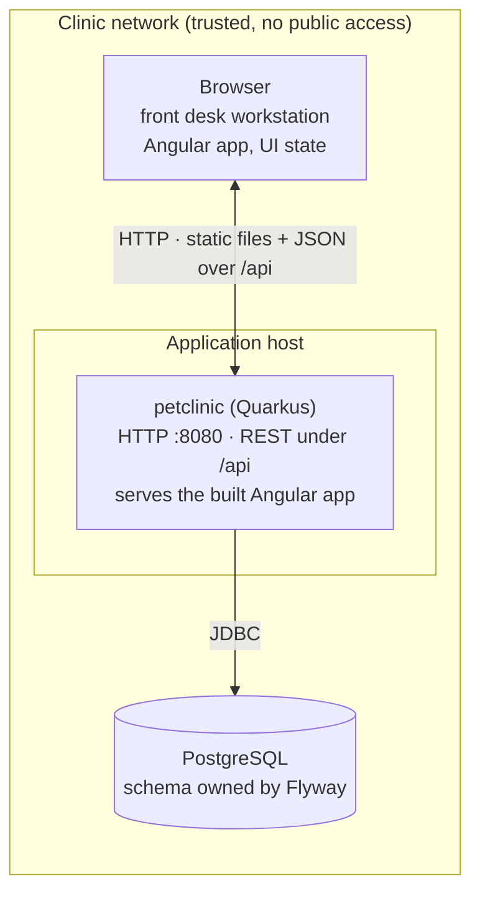

# Physical View

**Question:** Where does the system run?  
**Artifacts:** this document (deployment diagram, environments, constraints)  
**Notation:** Mermaid deployment diagram, Markdown  
**For the agent:** the boundary conditions. An agent that knows the database is
PostgreSQL, that the UI state lives in the browser while the server stays
stateless, and that the app runs on a trusted network inside the clinic decides
differently from one that does not.

## Deployment

Two nodes, one process each. No reverse proxy, no cache, no message broker, no
second service — the Logical and Process views have nothing that would need one.
The Angular application is not a separate server: `npm run build` leaves it in
`frontend/dist/petclinic/browser`, Maven copies it to `META-INF/resources`, and
Quarkus serves it as static content; `core/SpaRouting` answers every non-`/api`
path with `index.html` so the Angular router can take over.

## Environments

| Environment      | How it starts                                                            | Database                                                                   | Notes                                                                                                           |
|------------------|--------------------------------------------------------------------------|----------------------------------------------------------------------------|-----------------------------------------------------------------------------------------------------------------|
| **Local dev**    | `mvn quarkus:dev` (backend :8080) + `npm start` in `frontend/` (:4200)    | the `postgres` database on the local server (`vb-postgres start`), cleaned and migrated on every start, plus the seed | Open http://localhost:4200; the dev server proxies `/api` to :8080 (`proxy.conf.json`). Quarkus live reload and Angular's rebuild-on-save are active |
| **Build / test** | `mvn test` · `mvn verify` (frontend built first: `npm run build`)        | `petclinic_test` on localhost:5432, ensured by every Maven build, cleaned and migrated at test start | Dev Services are off, no Docker; `mvn test -Dgroups=sensor` needs neither the database nor the frontend build   |
| **CI**           | GitHub Actions, `ubuntu-latest`, JDK 25, Node; `npm run build`, `mvn -B verify` + Sonar scanner | a PostgreSQL server on the runner                         | `.github/workflows/build.yml`; caches `~/.m2`, `node_modules` and the Playwright browsers                      |
| **Production**   | `java -jar target/quarkus-app/quarkus-run.jar` (from `mvn package`, after `npm run build`) | an external PostgreSQL, `quarkus.datasource.*` from the environment | Target state — **nothing is deployed today**; see *Not there yet*                                               |

Flyway runs at startup (`quarkus.flyway.migrate-at-start=true`) and brings the
schema to the current version; Hibernate never touches it
(`quarkus.hibernate-orm.schema-management.strategy=none`). The test-only
`V2__seed_reference_data.sql` lives on the test classpath — the dev profile adds
it by path — and never reaches a production database.

## Runtime constraints

- **The server is stateless; UI state lives in the browser.** An open form, the
  current route and loaded lists are held by the Angular application, and every
  request to `/api` stands on its own. A second instance behind a load balancer
  needs no session affinity and no session replication. One instance is still
  assumed: nothing has been measured that would need more, and a reload of the
  browser loses an unsaved form either way.
- **One database, no read replicas.** Every query goes to the primary.
- **PostgreSQL only** (C-005). The migrations use PostgreSQL sequences and the
  entities map a PostgreSQL schema — the SQL is not portable, and it is not
  meant to be.
- **Port 8080** by default. Nothing but the Angular application and its `/api`
  is served: no health or metrics extension (`quarkus-smallrye-health`,
  `quarkus-micrometer`) is on the classpath, because no requirement asks for a
  health or metrics endpoint and an unsecured one would be the first thing to
  lock down.

## Security and data

- **No authentication, no authorization** (C-010). Whoever reaches the
  application can do everything a Clinic User can, including reading and
  changing customer data — through the pages or by calling `/api` directly.
  This is deliberate for the demo and is the single precondition of the whole
  deployment: **the application may not be exposed beyond the clinic's own
  network.** Adding authentication is the first change a real deployment needs,
  and it changes the Use Case View too (the Visitor / Clinic User split becomes
  enforced instead of implied).
- **TLS is not terminated by the application.** If it is needed, it belongs in
  front of the app.
- **Owner records are personal data** — name, address, telephone. No backup
  schedule, retention period, or hosting location is specified anywhere in
  `docs/`, and none can be invented here. For a real clinic these have to be
  supplied before deployment.

## Not there yet

Honest list of what a production deployment would add. None of it exists in the
repository today, so an agent should not pretend to change it:

- no container image (`quarkus-container-image-jib` would produce one),
- no infrastructure as code, no deployment pipeline beyond the CI build,
- no externalized production configuration (`application.properties` points at
  `localhost:5432` with fixed credentials in every environment that exists
  today),
- no monitoring, log aggregation, or alerting,
- no backup or restore procedure,
- no availability target, and no measured response-time budget to hold the
  "keeps up with a conversation" goal from the vision to.
