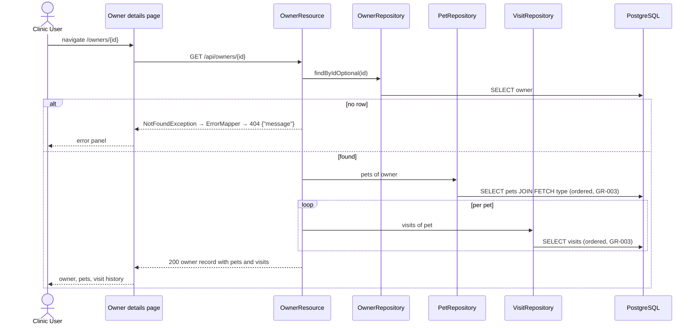
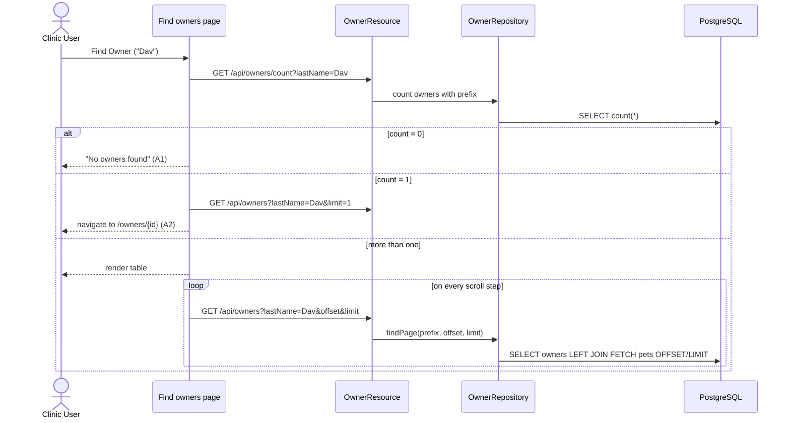
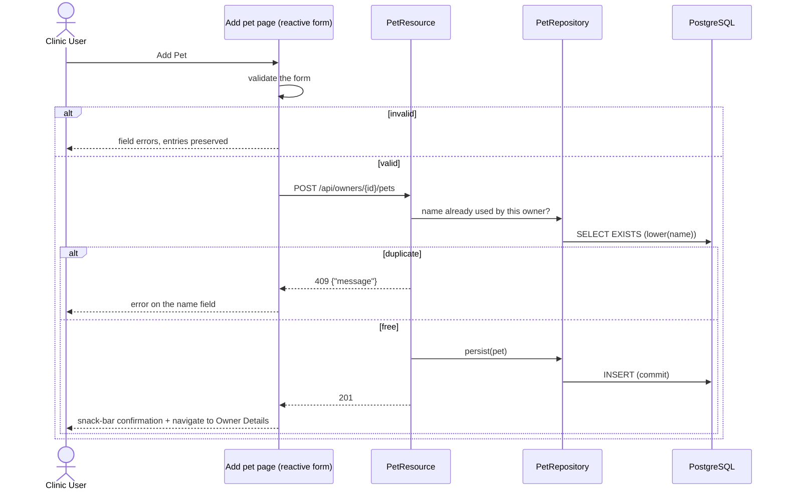

# Process View

**Question:** How does the system behave at runtime?  
**Artifacts:** this document (sequence diagrams, transaction boundaries,
concurrency rules)  
**Notation:** Mermaid sequence diagrams, Markdown for rules  
**For the agent:** where a transaction begins and ends, what runs in the
background (nothing, today), and which races are accepted. Without this view an
agent quietly builds everything into one synchronous request — which happens to
be right here, but for reasons worth knowing.

## Runtime shape

One server process, one browser application. A user action in the browser runs
in an Angular page, which sends an HTTP request to `/api/…`; Quarkus routes it
to a resource method, the resource calls a repository, the repository runs its
JPA queries against PostgreSQL in a transaction, and the resource answers with
JSON the page renders. Every other path is answered with `index.html`
(`core/SpaRouting`), and the Angular router takes it from there.

- **One page instance per navigation.** Angular creates the routed page
  component when the user navigates to it; its state (the loaded owner, the form
  contents) lives in the browser, in the component's signals, until the user
  navigates away. The server keeps no session: every request carries what it
  needs.
- **Repositories are singletons and stateless.** They are `@ApplicationScoped`
  Panache repositories; the persistence context lives only as long as the
  transaction of one repository call, so nothing about a user survives in them.
- **Requests are independent.** Quarkus runs each blocking resource method on a
  worker thread, and nothing serializes the requests of one user: a page that
  issues two requests may see them overlap. Nothing in memory is shared between
  them — the database is the only shared state.

## Reading a screen — UC-005 View Owner Details

The per-pet loop is an accepted `1 + 1 + n` — `n` is the number of pets of one
owner, which is small and bounded. The lists that are *not* bounded never do
this; see *Query cost* below.

## Searching — UC-004 Find Owners by Last Name

## Writing — UC-007 Add Pet to Owner

Every write in the application follows this shape: **validate in the form →
check what the database alone cannot check → one statement → confirm →
navigate.** The confirmation is not decoration; FR-022 requires it. Validation
lives in the form only (`domainIsValidationFree`); database constraints back it.

## Transaction boundaries

**The repository is the transaction boundary.** Every repository is annotated
`jakarta.transaction.Transactional` at class level, so each repository call
opens a transaction and commits it before returning. (JTA has no read-only
flag; reads and writes run the same way.) A resource never opens a transaction
— a resource method also serializes its answer to JSON, and a transaction that
spans that is held too long; worse, an entity that leaves the repository with
something lazy still unloaded fails in Jackson. So a repository returns fully
loaded results and the resource maps them to records.
`ArchitectureTest.repositoriesAreTransactional` and
`resourcesAreNotTransactional` keep it that way.

What that means per use case today:

- **Every use case writes exactly one row with one statement.** Register owner,
  update owner, add pet, update pet, book visit — one `INSERT` or `UPDATE` each,
  in one transaction of its own.
- **The reads of one screen are separate transactions.** The owner details
  request (UC-005) loads the owner, the pets, and each pet's visits in several
  repository calls, so several transactions, not one. Consistent per read, not
  across the screen — acceptable for a front desk reading one owner, and the
  alternative would mean a transaction in the resource.
- **A transaction never spans a user interaction.** The duplicate-name check and
  the insert that follows it are two repository calls and two transactions,
  deliberately; see below.

**The rule for the next use case:** the moment a use case needs *two* statements
to succeed or fail together, write **one** `@Transactional` repository method in
the owning feature's `domain` package that performs both, and add a line here
saying which use case made it necessary. Two calls from a resource are two
transactions, no matter what the resource does between them.

## Concurrency

- **A rule that needs a lookup before the write is a check-then-act.** The one
  that has it today is
  [GR-006](../business_rules.md#gr-006-unique-pet-name-per-owner) (UC-007 /
  UC-008 BR-001): the lookup and the `INSERT` are two transactions, so two
  clerks submitting the same name for the same owner at the same moment can
  both pass the check. The database is the backstop —
  `pets_owner_name_unique` is a unique index on `(owner_id, lower(name))`, which
  compares the way the rule says it must, so the loser of the race fails on the
  `INSERT` with Hibernate's `ConstraintViolationException`. It leaves the
  repository as a `RuntimeException`, `core/ErrorMapper` answers 500 with its
  message, and the page shows the error panel. The check in the resource exists
  to turn the common case into a field-level error instead of an error page.

  **The shape generalizes:** a rule the database cannot express alone is checked
  before the write, and where the data must never break it, a constraint that
  compares the same way is the backstop. Never the check alone.

- **Updates are last-write-wins.** No `@Version` column, no optimistic locking.
  Two clerks editing one record: the later save silently wins. No use case asks
  for more, and adding it would change the use cases that update — so it is a
  specification change first and a code change second.

- **No pessimistic locks (`LockModeType.PESSIMISTIC_*`), no `SELECT … FOR UPDATE`.**

## Synchronous and asynchronous processing

Everything is synchronous, inside the user's request:

| Mechanism                                   | Used? |
|---------------------------------------------|-------|
| Batch jobs / schedulers (`@Scheduled`)      | no    |
| Message queues / domain events              | no    |
| Reactive endpoints (`Uni`), background threads | no |
| Server push (SSE, WebSockets)               | no    |
| Caching layer (server or HTTP)              | no    |

(The browser's `HttpClient` calls are asynchronous; the server's answer is not.)
An agent must not introduce any of the above to solve a problem the
specification does not pose. If a use case ever needs one, it changes this table
and gets an ADR.

## Query cost

- **Unbounded lists load lazily** ([GR-002](../business_rules.md#gr-002-lazy-loading-of-lists),
  NFR-001/002): a repository `findPage(offset, limit)` behind
  `GET /api/<feature>?offset=&limit=`, with the resource capping `limit`, plus a
  paired `count()` where the use case needs the total. The page asks for the
  next chunk as the user scrolls towards the end of the list. Rows fetched per
  scroll step do not grow with the table size.
- **To-many data in a lazy list is fetched in the repository's query with
  `left join fetch`**, which Hibernate 7 pages in SQL, so a list never issues a
  query per row — the owner search results with their pet names (UC-004) and
  the vet directory with its specialties (UC-002).
- **Indexes carrying this:** `owners_last_name_idx` (prefix search),
  `pets_owner_name_unique` (leads with `owner_id`, so it serves the lookups by
  owner as well as the uniqueness check), `visits_pet_id_idx`.

## Failure paths

| At runtime                                  | Result                                                  |
|---------------------------------------------|---------------------------------------------------------|
| Entity missing in the resource              | `NotFoundException` → `ErrorMapper`, HTTP 404 `{"message": …}`; the page shows the error panel |
| Route the frontend does not have            | the `**` route, `NotFoundPage` (the server answered `index.html`) |
| Anything else thrown                        | `ErrorMapper`, HTTP 500 `{"message": …}`, logged on the server |
| JDBC / Hibernate failure                    | already a `RuntimeException` (`PersistenceException`), handled as above — no translation layer |

Every error page renders the same `core/error/error-panel.ts` **inside the
shell** (`app.html`), so the menu and toolbar stay usable (NFR-005), and it
shows the message only — never a stack trace (NFR-004, UC-010 BR-003).
`/oups` (`crash-page.ts`, calling `CrashResource` at `/api/oups`) exists to
demonstrate this path on purpose (UC-010 BR-004).
